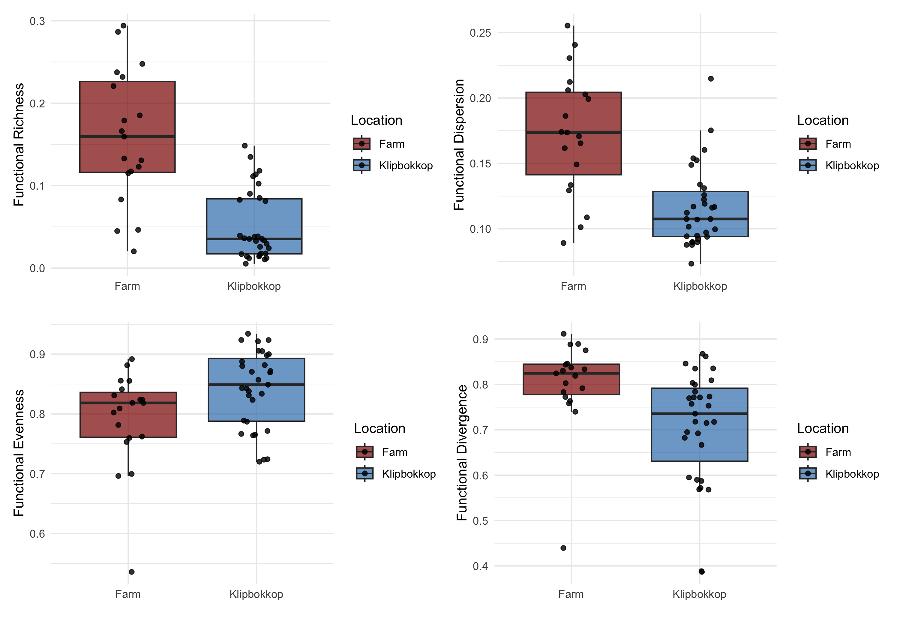

# Functional diversity of bird communities in protected fynbos vs farmland (Western Cape)

Field project testing how habitat modification affects the **functional diversity of bird communities**. It compares a protected fynbos reserve (**Klipbokkop**) with nearby farmland in **Modder Rivier**, near Worcester, Western Cape, South Africa. Bird point counts were combined with AVONET morphological and ecological traits to compute four functional diversity indices. Plant family composition was surveyed at the same points to characterise the two habitats.

*Imperial College London field course, Western Cape, October 2025. Group fieldwork; analysis and report by Markéta Šimková.*

📄 **Report:** [`report/Simkova_2025_bird_FD_fynbos.pdf`](report/Simkova_2025_bird_FD_fynbos.pdf)



## Question
Does a human-modified agricultural landscape support lower bird functional diversity than nearby protected fynbos? Or can farmland, with its mix of land uses, maintain a broader functional space?

## Methods
- **Sites:** Klipbokkop, protected fynbos at about 400 m elevation, and irrigated farmland with pastures and a reservoir at about 230 m. The sites are about 4 km apart.
- **Birds:** 50 ten-minute point counts following eBird protocol (31 Klipbokkop, 19 farmland), in early morning and late afternoon. 966 individuals were recorded.
- **Traits:** 9 traits from AVONET (Tobias et al. 2022): body mass, culmen length, nares length, beak width, beak depth, tarsus length, wing length, hand-wing index and trophic niche. Records identified only to genus ("sp.") and species without an AVONET match were excluded, leaving 64 species.
- **Functional diversity:** FRic, FEve, FDiv and FDis per point count with `FD::dbFD()`, using standardised traits, abundance weighting and Cailliez correction. Sites were compared with Wilcoxon rank-sum tests, because Shapiro–Wilk tests showed the indices were not normally distributed.
- **Vegetation:** three 4 m² quadrats per point, with plants identified to family. Quadrats were pooled per point and square-root transformed, then compared with Bray–Curtis dissimilarity and PERMANOVA (`vegan::adonis2`, 999 permutations).

## Key results
| Index | Farmland (mean ± SD) | Klipbokkop (mean ± SD) | Wilcoxon W | p |
|---|---|---|---|---|
| Functional richness (FRic) | 0.16 ± 0.08 | 0.05 ± 0.04 | 528 | < 0.001 |
| Functional dispersion (FDis) | 0.17 ± 0.05 | 0.12 ± 0.03 | 492 | < 0.001 |
| Functional evenness (FEve) | 0.79 ± 0.08 | 0.84 ± 0.06 | 171 | 0.014 |
| Functional divergence (FDiv) | 0.80 ± 0.10 | 0.71 ± 0.12 | 456 | 0.001 |

- **Farmland bird communities occupied a broader, more divergent functional space** (higher FRic, FDis and FDiv). Klipbokkop communities were more functionally even.
- **Plant family composition differed strongly between the sites:** site explained 53% of the variation (PERMANOVA F = 20.70, R² = 0.53, p = 0.001).

**Limitations:**
- There are only two sites, so habitat type is confounded with location and elevation.
- Point counts within a site are not fully independent.
- Sampling effort was unequal (31 vs 19 points).
- Seven recorded species had no AVONET match under the names used and were excluded.

## Reproducing the analysis
Tested with R 4.6.2; package versions are pinned in `renv.lock`. From the repository root:

```r
install.packages("renv")
renv::restore()        # installs the pinned package versions
source("run_all.R")    # or, from a shell: Rscript run_all.R
```

`run_all.R` rebuilds everything in `data/processed/` and `outputs/` from `data/raw/`. The map script downloads OpenStreetMap tiles once (about 50 tiles) into `data/external/osm_tiles/`. This folder is not committed.

## Repository structure
```
├── run_all.R                         # runs the full pipeline
├── R/
│   ├── 00_setup.R                    # packages, paths, colours
│   ├── 01_clean_join.R               # clean counts, attach scientific names + AVONET traits
│   ├── 02_vegetation_composition.R   # Bray–Curtis, PERMANOVA, PCoA
│   ├── 03_bird_fd.R                  # functional diversity per point count
│   ├── 04_fd_stats_figures.R         # site comparisons, Figure 3
│   └── 05_maps.R                     # Figures 1–2 (OpenStreetMap basemap)
├── data/
│   ├── raw/                          # field data, name map, AVONET trait subset (see data/README.md)
│   └── processed/                    # cleaned tables (generated)
├── outputs/
│   ├── figures/                      # fig1–3 as in the report, figS1–S2 supplementary (generated)
│   └── tables/                       # FD per point, summaries, tests, PERMANOVA (generated)
└── report/                           # submitted report (PDF)
```

## Data sources and licences
- **Code:** MIT ([LICENSE](LICENSE)).
- **Field data in `data/raw/`:** CC BY 4.0.
- **Trait data:** a subset of AVONET. Tobias, J. A. et al. (2022). AVONET: morphological, ecological and geographical data for all birds. *Ecology Letters* 25, 581–597. https://doi.org/10.1111/ele.13898
- **Map tiles:** © OpenStreetMap contributors, https://www.openstreetmap.org/copyright

## Citation
Šimková, M. (2025). *The effects of habitat modification on functional diversity of bird communities in the Western Cape.* Imperial College London. See [`CITATION.cff`](CITATION.cff).
